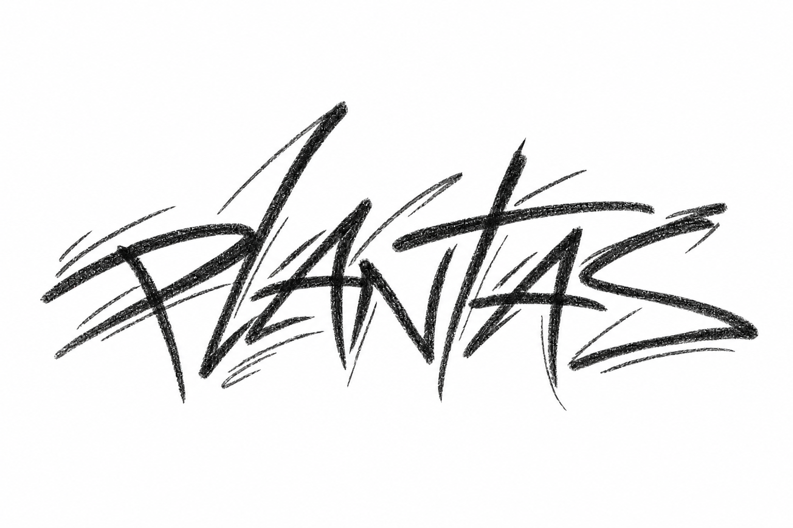

<div align="center">


<div align="center">
  <p>
    
    &nbsp; <sub>Technical Degree in Computing for Internet · IFRS</sub>
  </p>
</div>

<br/>

<a href="https://github.com/Yukii-O">
  
</a>
<a href="https://www.linkedin.com/in/alisson-de-andrade-assump%C3%A7%C3%A3o-604b9a35a/?isSelfProfile=true">
  
</a>
<a href="https://discord.com/users/708779168078495855">
  
</a>
<a href="https://www.instagram.com/xgalisson/">
  
</a>

</div>

```console
alisson@github:~$ whoami
Alisson de Andrade Assumpção

alisson@github:~$ cat about.txt
Back-end Developer focused on Nodejs and Java
I'm a future computer engineer, who do it for love
Currently learning and building projects
```
## `KEY TECHNOLOGIES`

<div align="center">


</div>

## `LEARNING ABOUT`

<div align="center">


</div>

## `KEY PROJECTS`

<div align="left">
  
<a href="https://github.com/Yukii-O/recipe-finder-app">
  
</a>

</div>

→ [See more](https://github.com/Yukii-0?tab=repositories)
## `OPEN SOURCE`
<div>
  
</div>

## `ACTIVITY`

<div align="center">


</div>

---

<div align="center">
  
</div>
